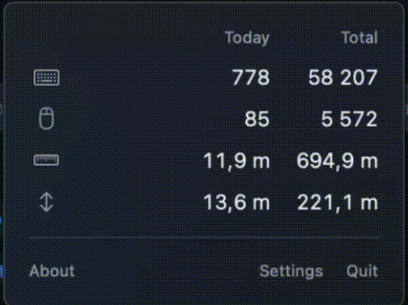

# KeyMeter

Маленькое приложение для строки меню macOS. Считает нажатия клавиш, клики, путь курсора и прокрутку в метрах.

A tiny macOS menu bar app. Counts keystrokes, clicks, cursor travel and scrolling in meters.



 


## Установка

Нужен macOS 13 или новее, Apple Silicon и Intel.

Через Homebrew (после него выполните шаги 3 и 4 ниже):
```
brew install --cask cheeselover419/keymeter/keymeter
```

Или вручную:

1. Скачайте `KeyMeter-1.0.dmg` на странице [Releases](https://github.com/cheeselover419/keymeter/releases/latest).
2. Откройте образ и перетащите KeyMeter в «Программы».
3. Приложение не подписано сертификатом Apple Developer, поэтому при первом запуске macOS его блокирует. Откройте «Системные настройки → Конфиденциальность и безопасность», найдите сообщение о KeyMeter и нажмите «Всё равно открыть». Либо снимите карантин в терминале:
   ```
   xattr -dr com.apple.quarantine /Applications/KeyMeter.app
   ```
4. Включите KeyMeter в «Конфиденциальность и безопасность → Мониторинг ввода» и запустите приложение заново. Без этого оно не видит нажатия.

## Install

Requires macOS 13 or later, Apple Silicon and Intel.

With Homebrew (then do steps 3 and 4 below):
```
brew install --cask cheeselover419/keymeter/keymeter
```

Or manually:

1. Download `KeyMeter-1.0.dmg` from [Releases](https://github.com/cheeselover419/keymeter/releases/latest).
2. Open the image and drag KeyMeter to Applications.
3. The app is not signed with an Apple Developer certificate, so macOS blocks it on first launch. Open System Settings → Privacy & Security, find the message about KeyMeter and click "Open Anyway". Or remove the quarantine flag in Terminal:
   ```
   xattr -dr com.apple.quarantine /Applications/KeyMeter.app
   ```
4. Enable KeyMeter under Privacy & Security → Input Monitoring and relaunch the app. Without it the app cannot see keystrokes.

## Лицензия / License

MIT
