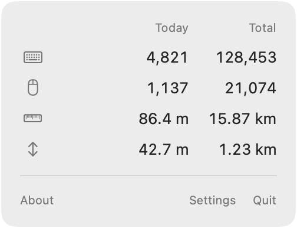

# KeyMeter

Маленькое приложение для строки меню macOS. Считает нажатия клавиш, клики, путь курсора и прокрутку в метрах.

A tiny macOS menu bar app. Counts keystrokes, clicks, cursor travel and scrolling in meters.

 
